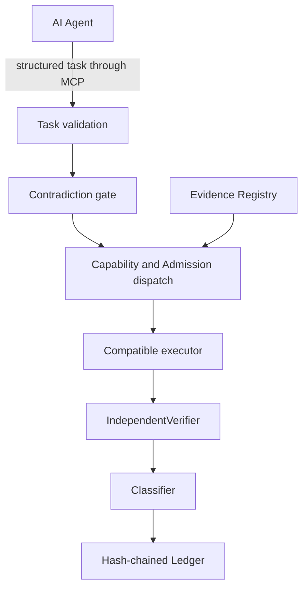

# DPCO V3 Core Architecture

This reference describes the implementation and documentation in the published [DPCO V3 repository](https://github.com/a50kv109/dpco-v3). It does not imply that the Skill repository includes or runs the Core.

## Component flow

The short conceptual pipeline is:

`Admission → Executor → IndependentVerifier → Ledger`

In the Core, validation and the contradiction gate precede dispatch, while classification is applied before the final record.

## Responsibilities

### DPCOCore

`DPCOCore.processTask` coordinates validation, contradiction checks, executor selection, synchronous execution, verification, classification, and ledger finalization. It keeps the execution status, claim verdict, and verification status as separate values.

Source: [DPCOCore](https://github.com/a50kv109/dpco-v3/blob/main/src/core/dpcoCore.ts), [task and status models](https://github.com/a50kv109/dpco-v3/blob/main/src/core/models.ts).

### Capability registry and executors

The registry records executor capabilities and metadata. The dispatcher selects an executor only when it is compatible with the task and its admission/evidence requirements. Registering an executor or enabling an implementation is not itself a production grant.

Source: [registry and compatibility checks](https://github.com/a50kv109/dpco-v3/blob/main/src/core/registry.ts), [executor implementations](https://github.com/a50kv109/dpco-v3/blob/main/src/core/executors.ts), [capability manifest](https://github.com/a50kv109/dpco-v3/blob/main/src/core/capabilityManifest.ts).

### Evidence and Admission

Evidence and `AdmissionGrant` records are held in memory. An active grant controls the effective executor role; production dispatch also checks compatible evidence for the requested rigor and domain. A fresh default Core has no automatic grants or synthetic passing-test evidence and is fail-closed. The normal MCP tools do not issue grants or mutate qualification state.

The evidence-ingestion contract validates required fields, but caller-provided harness identity is not cryptographic proof that a trusted harness produced the evidence.

Source: [EvidenceRegistry and AdmissionGrant](https://github.com/a50kv109/dpco-v3/blob/main/src/core/evidence.ts), [Core architecture](https://github.com/a50kv109/dpco-v3/blob/main/docs/DPCO_V3_ARCHITECTURE.md), [MCP security](https://github.com/a50kv109/dpco-v3/blob/main/docs/MCP_SECURITY.md).

### IndependentVerifier

The verifier checks operation-specific properties: substitution/residuals for arithmetic and systems, and exact incidence or other supported predicates for geometry. The label “IndependentVerifier” does not mean formal or fully independent implementation: rational executor and verifier paths share `Fraction`/BigInt arithmetic, a common-mode risk.

For multivariable systems, a zero residual establishes that the returned vector satisfies `A·x=b`; it does not establish uniqueness or full column rank.

Source: [IndependentVerifier](https://github.com/a50kv109/dpco-v3/blob/main/src/core/verifier.ts), [multivariable residual verifier](https://github.com/a50kv109/dpco-v3/blob/main/src/core/multiVarVerify.ts), [known limitations](https://github.com/a50kv109/dpco-v3/blob/main/docs/KNOWN_LIMITATIONS.md).

### Ledger

The ledger appends records with a previous-record hash and a SHA-256 record hash. This can detect modification relative to the stored chain; it is not a signed, externally anchored, durable audit service. MCP task lookup is scoped to the current server process/Core.

Source: [ExecutionLedger](https://github.com/a50kv109/dpco-v3/blob/main/src/core/ledger.ts), [MCP integration](https://github.com/a50kv109/dpco-v3/blob/main/docs/MCP_INTEGRATION.md).

## Limits

- Core operations execute synchronously in-process; this is not OS, container, or subprocess isolation.
- Evidence and grants are in-memory and are not signed or durably stored.
- The ledger hash does not serve as a cryptographic commitment to every returned result payload.
- DPCO does not claim complete mathematical correctness, a universal theorem prover, or general workflow orchestration.
- DEAS-1 is designed, not an operational external executor runtime.

See [DPCO V3 architecture](https://github.com/a50kv109/dpco-v3/blob/main/docs/DPCO_V3_ARCHITECTURE.md) and [known limitations](https://github.com/a50kv109/dpco-v3/blob/main/docs/KNOWN_LIMITATIONS.md).
